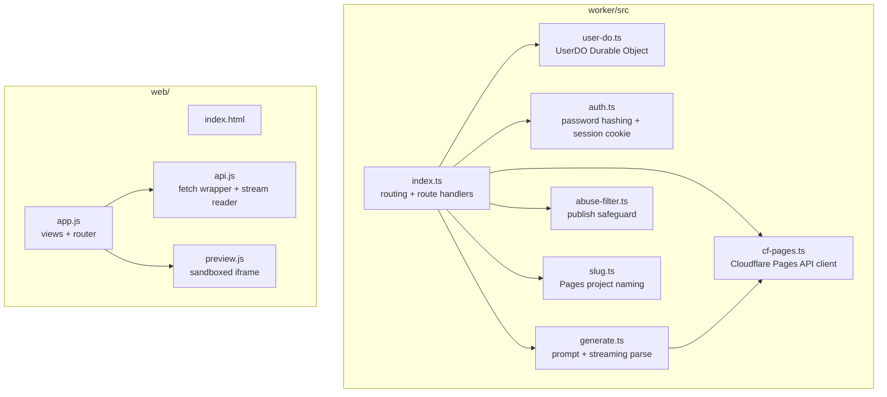
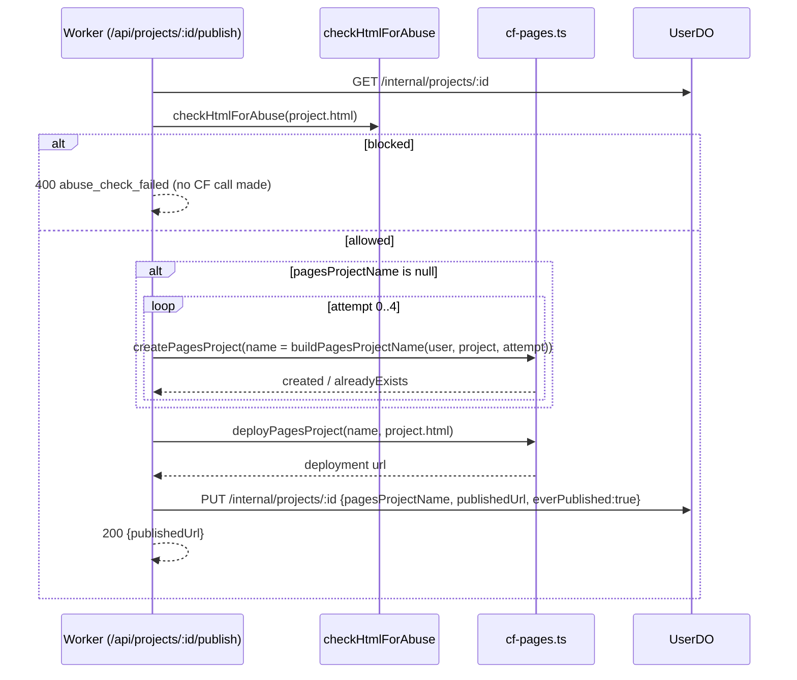

# AI Page Builder Implementation Plan

> **For agentic workers:** REQUIRED SUB-SKILL: Use superpowers:subagent-driven-development (recommended) or superpowers:executing-plans to implement this plan task-by-task. Steps use checkbox (`- [ ]`) syntax for tracking.

**Goal:** Build the multi-user, chat-driven, single-page HTML site builder described in the design doc: login, a projects list, a chat+preview editor with streamed AI responses, and one-click publish/delete against per-project Cloudflare Pages projects.

**Architecture:** A Cloudflare Worker (TypeScript) exposes a small JSON/REST API and routes every request to a per-user Durable Object (`UserDO`) that stores that user's credentials and all of their projects (HTML, chat history, publish state) as DO storage. The Worker calls Workers AI (streamed) for chat-driven edits and the Cloudflare Pages REST API for publish/delete. A plain-JS static frontend (deployed to Cloudflare Pages) talks to the Worker over `fetch`, holds the sandboxed preview iframe, and renders the streamed chat reply as it arrives.

**Tech Stack:** Cloudflare Workers + Durable Objects + Workers AI, Cloudflare Pages (direct-upload API), TypeScript, `vitest` + `@cloudflare/vitest-pool-workers` for Worker tests, plain JS (no framework/bundler) for the frontend, `vitest` + `jsdom` for frontend pure-logic tests.

**Spec:** `docs/superpowers/specs/2026-10-22-ai-page-builder-design.md`

## Global Constraints

- Single HTML page per project (inline CSS/JS allowed); no multi-page sites.
- Each project gets its **own** Cloudflare Pages project (own default `*.pages.dev` URL) — never a shared project with path routing.
- Auth is username + password only — no OAuth, no email verification, no password reset flow.
- One Durable Object per user (`UserDO`), addressed by username, storing that user's credentials and all projects as a single JSON blob — no per-project DO, no relational DB.
- AI edits regenerate the **full HTML** each turn (current HTML + new message in, full new HTML out) — not a diff/patch.
- The AI's reply streams token-by-token into the chat; the live preview iframe only refreshes once the full HTML has been received and stored (not token-by-token).
- The preview iframe renders via `srcdoc` with a `sandbox` attribute and **no** `allow-same-origin`, so preview content can never touch the parent app's cookies/session.
- Publish runs a basic automated abuse check on the HTML before any Cloudflare Pages API call, on **every** publish (not just the first), and blocks with an error if it trips.
- Delete removes the project's Cloudflare Pages project (if it was ever published) and then the DO entry; if the Pages deletion call fails, the project is **not** removed and the user sees a retry error.
- The Cloudflare API token/account id live only as Worker secrets, never sent to the browser.

## Review Focus

- A protected route (projects, chat, publish, delete) with no session cookie, or a tampered one, returns 401 rather than succeeding or crashing.
- A session cookie with a valid signature but an expired `exp` is rejected, not just an unsigned/garbled one.
- Registering a username that already exists returns 409 and leaves the original user record untouched.
- Deleting a project that was never published skips the Cloudflare Pages delete call entirely and still succeeds locally.
- Publishing HTML that trips the abuse filter is blocked **before** any Cloudflare Pages API call (no orphaned Pages project from a blocked publish).

---

## File Structure



- `worker/src/auth.ts` — password hashing (PBKDF2-SHA256 via Web Crypto) and session cookie signing/verification (HMAC). Pure functions, no DO access.
- `worker/src/user-do.ts` — the `UserDO` class. Internal `fetch`-routed API (`/internal/user`, `/internal/projects`, `/internal/projects/:id`) used only by `index.ts` via the DO stub.
- `worker/src/generate.ts` — builds the model prompt from current HTML + message, drives the streamed Workers AI call, and extracts the final HTML from the model's raw output.
- `worker/src/cf-pages.ts` — thin client for the three Cloudflare Pages REST calls this app needs: create project, direct-upload deploy, delete project.
- `worker/src/abuse-filter.ts` — the basic pre-publish safeguard rule.
- `worker/src/slug.ts` — deterministic, collision-suffixed Pages project naming.
- `worker/src/index.ts` — the Worker's `fetch` entry point: parses routes, enforces the session cookie on protected routes, and wires the modules above together.
- `web/api.js` — every Worker API call the frontend makes, including the streamed chat reader.
- `web/preview.js` — sets up and refreshes the sandboxed preview iframe.
- `web/app.js` — views (login/register, projects list, editor) and the mobile chat/preview tab toggle; wires `api.js` and `preview.js` together.

---

### Task 1: Worker test harness

**Files:**
- Modify: `worker/package.json`
- Create: `worker/vitest.config.ts`
- Create: `worker/test/health.test.ts`

**Interfaces:**
- Produces: a working `npm test` in `worker/` using `@cloudflare/vitest-pool-workers`, which every later Worker task's tests rely on.

- [ ] **Step 1: Add `vitest`, `@cloudflare/vitest-pool-workers`, and a `test` script to `worker/package.json`**

`"test": "vitest run"`.

- [ ] **Step 2: Create `worker/vitest.config.ts`** configuring the `@cloudflare/vitest-pool-workers` pool against `worker/wrangler.toml`, per that package's standard Vitest pool setup.

- [ ] **Step 3: Write `worker/test/health.test.ts`**

```ts
import { SELF } from "cloudflare:test";
import { describe, it, expect } from "vitest";

describe("health", () => {
  it("GET /api/health returns ok", async () => {
    const res = await SELF.fetch("https://example.com/api/health");
    expect(res.status).toBe(200);
    expect(await res.json()).toEqual({ ok: true });
  });
});
```

- [ ] **Step 4: Run `npm test` in `worker/` and verify it passes**

Expected: PASS (the `/api/health` route already exists from the scaffold).

- [ ] **Step 5: Commit**

```bash
git add worker/package.json worker/vitest.config.ts worker/test/health.test.ts
git commit -m "test: add worker vitest harness"
```

---

### Task 2: Password hashing

**Files:**
- Create: `worker/src/auth.ts`
- Test: `worker/test/auth.hashing.test.ts`

**Interfaces:**
- Produces: `hashPassword(password: string): Promise<{ hash: string; salt: string }>`; `verifyPassword(password: string, hash: string, salt: string): Promise<boolean>`.

- [ ] **Step 1: Write the failing tests**

```ts
it("verifyPassword returns true for the correct password", async () => {
  const { hash, salt } = await hashPassword("correct-horse");
  expect(await verifyPassword("correct-horse", hash, salt)).toBe(true);
});

it("verifyPassword returns false for the wrong password", async () => {
  const { hash, salt } = await hashPassword("correct-horse");
  expect(await verifyPassword("wrong", hash, salt)).toBe(false);
});

it("hashing the same password twice produces different hashes (random salt)", async () => {
  const a = await hashPassword("same-password");
  const b = await hashPassword("same-password");
  expect(a.salt).not.toBe(b.salt);
  expect(a.hash).not.toBe(b.hash);
});
```

- [ ] **Step 2: Run `npm test`, verify these three fail** (module doesn't exist yet).

- [ ] **Step 3: Implement `hashPassword` and `verifyPassword` in `worker/src/auth.ts`**

Use `crypto.getRandomValues` for the salt and `crypto.subtle.deriveBits`/`importKey` with PBKDF2-SHA256 for the hash, encoding both as base64.

- [ ] **Step 4: Run `npm test`, verify all pass.**

- [ ] **Step 5: Commit**

```bash
git add worker/src/auth.ts worker/test/auth.hashing.test.ts
git commit -m "feat: add password hashing"
```

---

### Task 3: Session cookie signing & verification

**Files:**
- Modify: `worker/src/auth.ts`
- Test: `worker/test/auth.session.test.ts`

**Interfaces:**
- Consumes: nothing from Task 2 (independent functions in the same file).
- Produces: `signSession(username: string, secret: string, ttlSeconds: number): Promise<string>` (a cookie value); `verifySession(cookieValue: string, secret: string): Promise<{ username: string } | null>`.

- [ ] **Step 1: Write the failing tests**

```ts
it("verifySession returns the username for a freshly signed cookie", async () => {
  const cookie = await signSession("alice", "secret", 3600);
  expect(await verifySession(cookie, "secret")).toEqual({ username: "alice" });
});

it("verifySession rejects a tampered signature", async () => {
  const cookie = await signSession("alice", "secret", 3600);
  const tampered = cookie.slice(0, -2) + "xx";
  expect(await verifySession(tampered, "secret")).toBeNull();
});

it("verifySession rejects an expired cookie even with a valid signature", async () => {
  const cookie = await signSession("alice", "secret", -1);
  expect(await verifySession(cookie, "secret")).toBeNull();
});
```

- [ ] **Step 2: Run `npm test`, verify these three fail.**

- [ ] **Step 3: Implement `signSession`/`verifySession` in `worker/src/auth.ts`**

Cookie value is `base64url(JSON{username, exp}) + "." + base64url(HMAC-SHA256(secret, payload))`. `verifySession` recomputes the HMAC, rejects on mismatch, then rejects if `exp` is in the past.

- [ ] **Step 4: Run `npm test`, verify all pass.**

- [ ] **Step 5: Commit**

```bash
git add worker/src/auth.ts worker/test/auth.session.test.ts
git commit -m "feat: add session cookie signing and verification"
```

---

### Task 4: UserDO — user record storage

**Files:**
- Modify: `worker/src/user-do.ts`
- Test: `worker/test/user-do.user.test.ts`

**Interfaces:**
- Produces (internal DO HTTP API, called only via the DO stub): `GET /internal/user` → `200 { username, passwordHash, passwordSalt, projects: [] }` | `404`; `POST /internal/user` with body `{ passwordHash, passwordSalt }` → `201 { username }` | `409 { error: "username_taken" }` if a record already exists.

- [ ] **Step 1: Write the failing tests**

```ts
import { env } from "cloudflare:test";

it("creates a user then returns it on GET", async () => {
  const id = env.USER_DO.idFromName("alice");
  const stub = env.USER_DO.get(id);
  const create = await stub.fetch("https://do/internal/user", {
    method: "POST",
    body: JSON.stringify({ passwordHash: "h", passwordSalt: "s" }),
  });
  expect(create.status).toBe(201);
  const get = await stub.fetch("https://do/internal/user");
  expect(get.status).toBe(200);
  expect(await get.json()).toMatchObject({ username: "alice", passwordHash: "h" });
});

it("rejects creating a second record for the same DO with 409", async () => {
  const id = env.USER_DO.idFromName("bob");
  const stub = env.USER_DO.get(id);
  await stub.fetch("https://do/internal/user", { method: "POST", body: JSON.stringify({ passwordHash: "h1", passwordSalt: "s1" }) });
  const second = await stub.fetch("https://do/internal/user", { method: "POST", body: JSON.stringify({ passwordHash: "h2", passwordSalt: "s2" }) });
  expect(second.status).toBe(409);
  const get = await stub.fetch("https://do/internal/user");
  expect((await get.json()).passwordHash).toBe("h1");
});
```

- [ ] **Step 2: Run `npm test`, verify these two fail** (`UserDO.fetch` currently returns 501 for everything).

- [ ] **Step 3: Implement user-record routing in `UserDO.fetch`**

The DO derives its own username from `this.state.id.name` (set by `idFromName`) the first time a record is created, and stores the `UserRecord` (per the spec's data model, with `projects: []` initially) via `this.state.storage`.

- [ ] **Step 4: Run `npm test`, verify all pass.**

- [ ] **Step 5: Commit**

```bash
git add worker/src/user-do.ts worker/test/user-do.user.test.ts
git commit -m "feat: add UserDO user-record storage"
```

---

### Task 5: Register & login routes

**Files:**
- Modify: `worker/src/index.ts`
- Test: `worker/test/register-login.test.ts`

**Interfaces:**
- Consumes: `hashPassword`, `verifyPassword`, `signSession` (Tasks 2–3); the `/internal/user` DO routes (Task 4).
- Produces: `POST /api/register` body `{ username, password }` → `201 { ok: true }` | `409 { error: "username_taken" }`; `POST /api/login` body `{ username, password }` → `200 { ok: true }` with `Set-Cookie: session=...` | `401 { error: "invalid_credentials" }`.

- [ ] **Step 1: Write the failing tests**

```ts
it("registers a new user", async () => {
  const res = await SELF.fetch("https://example.com/api/register", {
    method: "POST", body: JSON.stringify({ username: "alice", password: "pw123456" }),
  });
  expect(res.status).toBe(201);
});

it("rejects registering a username that already exists, leaving the original untouched", async () => {
  await SELF.fetch("https://example.com/api/register", { method: "POST", body: JSON.stringify({ username: "carol", password: "first-pw" }) });
  const dup = await SELF.fetch("https://example.com/api/register", { method: "POST", body: JSON.stringify({ username: "carol", password: "second-pw" }) });
  expect(dup.status).toBe(409);
  const login = await SELF.fetch("https://example.com/api/login", { method: "POST", body: JSON.stringify({ username: "carol", password: "first-pw" }) });
  expect(login.status).toBe(200);
});

it("rejects login with the wrong password", async () => {
  await SELF.fetch("https://example.com/api/register", { method: "POST", body: JSON.stringify({ username: "dave", password: "right-pw" }) });
  const res = await SELF.fetch("https://example.com/api/login", { method: "POST", body: JSON.stringify({ username: "dave", password: "wrong-pw" }) });
  expect(res.status).toBe(401);
});

it("sets a session cookie on successful login", async () => {
  await SELF.fetch("https://example.com/api/register", { method: "POST", body: JSON.stringify({ username: "erin", password: "right-pw" }) });
  const res = await SELF.fetch("https://example.com/api/login", { method: "POST", body: JSON.stringify({ username: "erin", password: "right-pw" }) });
  expect(res.headers.get("set-cookie")).toMatch(/^session=/);
});
```

- [ ] **Step 2: Run `npm test`, verify these four fail.**

- [ ] **Step 3: Implement `/api/register` and `/api/login` in `index.ts`**

Register: hash the password, `POST` to the user's DO stub (`env.USER_DO.idFromName(username)`), map DO 409 to route 409. Login: `GET` the DO's user record, 401 if missing, `verifyPassword`, 401 on mismatch, else `signSession` and set it as a `Set-Cookie` (`HttpOnly; Secure; SameSite=Lax; Path=/`).

- [ ] **Step 4: Run `npm test`, verify all pass.**

- [ ] **Step 5: Commit**

```bash
git add worker/src/index.ts worker/test/register-login.test.ts
git commit -m "feat: add register and login routes"
```

---

### Task 6: Session guard, logout, and project create/list

**Files:**
- Modify: `worker/src/index.ts`
- Modify: `worker/src/user-do.ts`
- Test: `worker/test/projects-list-create.test.ts`

**Interfaces:**
- Consumes: `verifySession` (Task 3).
- Produces (DO): `GET /internal/projects` → `200 { projects: [{ id, name, everPublished, publishedUrl }] }`; `POST /internal/projects` body `{ name }` → `201 { project: Project }` (full `Project` shape per the spec's data model, with empty `html`, empty `chatHistory`, `pagesProjectName: null`, `publishedUrl: null`, `everPublished: false`).
- Produces (Worker): a `requireSession(request, env): Promise<{ username: string } | Response>` helper other protected routes reuse; `GET /api/projects` → `200 { projects }` | `401`; `POST /api/projects` body `{ name }` → `201 { project }` | `401`; `POST /api/logout` → `200`, clears the cookie.

- [ ] **Step 1: Write the failing tests**

```ts
it("rejects /api/projects with no session cookie", async () => {
  const res = await SELF.fetch("https://example.com/api/projects");
  expect(res.status).toBe(401);
});

it("creates and lists a project for the logged-in user", async () => {
  const cookie = await registerAndLogin("fay", "pw123456"); // test helper using the two routes from Task 5
  const create = await SELF.fetch("https://example.com/api/projects", {
    method: "POST", headers: { Cookie: cookie }, body: JSON.stringify({ name: "My Site" }),
  });
  expect(create.status).toBe(201);
  const list = await SELF.fetch("https://example.com/api/projects", { headers: { Cookie: cookie } });
  const body = await list.json();
  expect(body.projects).toHaveLength(1);
  expect(body.projects[0].name).toBe("My Site");
});

it("logout clears the session so a later request is rejected", async () => {
  const cookie = await registerAndLogin("gina", "pw123456");
  await SELF.fetch("https://example.com/api/logout", { method: "POST", headers: { Cookie: cookie } });
  const res = await SELF.fetch("https://example.com/api/projects", { headers: { Cookie: cookie } });
  expect(res.status).toBe(401);
});
```

- [ ] **Step 2: Run `npm test`, verify these three fail.**

- [ ] **Step 3: Implement `/internal/projects` (GET/POST) in `UserDO.fetch`**, generating project ids with `crypto.randomUUID()`.

- [ ] **Step 4: Implement `requireSession`, `/api/projects` (GET/POST), and `/api/logout` in `index.ts`**

`requireSession` reads the `Cookie` header, extracts `session=`, calls `verifySession`; on failure returns a `401` `Response` directly (callers check `instanceof Response`). `/api/logout` responds with a `Set-Cookie` that overwrites `session` with `Max-Age=0`.

- [ ] **Step 5: Run `npm test`, verify all pass.**

- [ ] **Step 6: Commit**

```bash
git add worker/src/index.ts worker/src/user-do.ts worker/test/projects-list-create.test.ts
git commit -m "feat: add session guard, logout, and project list/create"
```

---

### Task 7: Get single project

**Files:**
- Modify: `worker/src/index.ts`
- Modify: `worker/src/user-do.ts`
- Test: `worker/test/project-get.test.ts`

**Interfaces:**
- Consumes: `requireSession` (Task 6).
- Produces (DO): `GET /internal/projects/:id` → `200 { project: Project }` | `404`.
- Produces (Worker): `GET /api/projects/:id` → `200 { project }` | `404` | `401`.

- [ ] **Step 1: Write the failing tests**

```ts
it("gets a project the user owns", async () => {
  const cookie = await registerAndLogin("hank", "pw123456");
  const created = await createProject(cookie, "Portfolio"); // test helper
  const res = await SELF.fetch(`https://example.com/api/projects/${created.id}`, { headers: { Cookie: cookie } });
  expect(res.status).toBe(200);
  expect((await res.json()).project.name).toBe("Portfolio");
});

it("returns 404 for an id that doesn't exist", async () => {
  const cookie = await registerAndLogin("ivy", "pw123456");
  const res = await SELF.fetch("https://example.com/api/projects/does-not-exist", { headers: { Cookie: cookie } });
  expect(res.status).toBe(404);
});
```

- [ ] **Step 2: Run `npm test`, verify these two fail.**

- [ ] **Step 3: Implement `GET /internal/projects/:id` in `UserDO.fetch` and `GET /api/projects/:id` in `index.ts`.**

- [ ] **Step 4: Run `npm test`, verify all pass.**

- [ ] **Step 5: Commit**

```bash
git add worker/src/index.ts worker/src/user-do.ts worker/test/project-get.test.ts
git commit -m "feat: add get single project route"
```

---

### Task 8: Abuse filter

**Files:**
- Create: `worker/src/abuse-filter.ts`
- Test: `worker/test/abuse-filter.test.ts`

**Interfaces:**
- Produces: `checkHtmlForAbuse(html: string): { blocked: boolean; reason?: string }`.

- [ ] **Step 1: Write the failing tests**

```ts
it("allows a plain page with no forms", () => {
  expect(checkHtmlForAbuse("<html><body>Hello</body></html>")).toEqual({ blocked: false });
});

it("blocks a form posting to an external domain alongside credential-harvesting language", () => {
  const html = `<form action="https://evil.example.com/collect"><p>Enter your password to continue</p></form>`;
  const result = checkHtmlForAbuse(html);
  expect(result.blocked).toBe(true);
  expect(result.reason).toMatch(/external/i);
});

it("allows a form posting to a relative path even if it mentions a password", () => {
  const html = `<form action="/submit"><p>password</p></form>`;
  expect(checkHtmlForAbuse(html)).toEqual({ blocked: false });
});
```

- [ ] **Step 2: Run `npm test`, verify these three fail.**

- [ ] **Step 3: Implement `checkHtmlForAbuse`**

Blocked when the HTML contains a `<form ... action="http(s)://...">` (absolute URL) **and** the document text matches at least one of a small keyword list (e.g. `password`, `verify your account`, `bank`, `credit card`, `social security`), case-insensitive.

- [ ] **Step 4: Run `npm test`, verify all pass.**

- [ ] **Step 5: Commit**

```bash
git add worker/src/abuse-filter.ts worker/test/abuse-filter.test.ts
git commit -m "feat: add basic publish abuse filter"
```

---

### Task 9: Cloudflare Pages API client

**Files:**
- Create: `worker/src/cf-pages.ts`
- Test: `worker/test/cf-pages.test.ts`

**Interfaces:**
- Produces: `createPagesProject(accountId: string, apiToken: string, projectName: string): Promise<{ created: boolean; alreadyExists: boolean; subdomain?: string }>`; `deployPagesProject(accountId: string, apiToken: string, projectName: string, html: string): Promise<{ url: string }>`; `deletePagesProject(accountId: string, apiToken: string, projectName: string): Promise<{ ok: boolean }>`.

- [ ] **Step 1: Write the failing tests**, mocking `globalThis.fetch` with `vi.fn()` to return canned Cloudflare API responses for each case:

```ts
it("createPagesProject reports created:true on a fresh name", async () => { /* mock fetch -> 200 success:true */ });
it("createPagesProject reports alreadyExists:true on a name-taken error", async () => { /* mock fetch -> 400 with Cloudflare's "already exists" error code */ });
it("deployPagesProject returns the deployment url", async () => { /* mock fetch -> 200 with result.url */ });
it("deletePagesProject returns ok:false on a non-2xx response", async () => { /* mock fetch -> 500 */ });
```

- [ ] **Step 2: Run `npm test`, verify these four fail.**

- [ ] **Step 3: Implement the three functions in `cf-pages.ts`**

Each calls the Cloudflare REST API (`https://api.cloudflare.com/client/v4/accounts/{accountId}/pages/projects...`) with `Authorization: Bearer {apiToken}`; `createPagesProject` distinguishes the "already exists" case by the response's Cloudflare error code rather than just HTTP status.

- [ ] **Step 4: Run `npm test`, verify all pass.**

- [ ] **Step 5: Commit**

```bash
git add worker/src/cf-pages.ts worker/test/cf-pages.test.ts
git commit -m "feat: add Cloudflare Pages API client"
```

---

### Task 10: Pages project slug generation

**Files:**
- Create: `worker/src/slug.ts`
- Test: `worker/test/slug.test.ts`

**Interfaces:**
- Produces: `slugify(input: string): string`; `buildPagesProjectName(username: string, projectName: string, attempt: number): string`.

- [ ] **Step 1: Write the failing tests**

```ts
it("slugify lowercases and strips non-alphanumeric characters to hyphens", () => {
  expect(slugify("My Cool Site!!")).toBe("my-cool-site");
});

it("buildPagesProjectName combines username and project name", () => {
  expect(buildPagesProjectName("alice", "My Site", 0)).toBe("alice-my-site");
});

it("buildPagesProjectName appends the attempt number past zero", () => {
  expect(buildPagesProjectName("alice", "My Site", 2)).toBe("alice-my-site-2");
});
```

- [ ] **Step 2: Run `npm test`, verify these three fail.**

- [ ] **Step 3: Implement `slugify` and `buildPagesProjectName`.**

- [ ] **Step 4: Run `npm test`, verify all pass.**

- [ ] **Step 5: Commit**

```bash
git add worker/src/slug.ts worker/test/slug.test.ts
git commit -m "feat: add Pages project slug generation"
```

---

### Task 11: Publish endpoint

**Files:**
- Modify: `worker/src/index.ts`
- Modify: `worker/src/user-do.ts`

**Interfaces:**
- Consumes: `requireSession` (Task 6); `checkHtmlForAbuse` (Task 8); `createPagesProject`/`deployPagesProject` (Task 9); `buildPagesProjectName` (Task 10).
- Produces (DO): `PUT /internal/projects/:id` body `{ pagesProjectName?, publishedUrl?, everPublished? }` → `200 { project: Project }` (merges the given fields into the stored project).
- Produces (Worker): `POST /api/projects/:id/publish` → `200 { publishedUrl }` | `400 { error: "abuse_check_failed", reason }` | `404` | `401` | `502 { error: "cf_api_error" }`.



- [ ] **Step 1: Write the failing tests** in `worker/test/publish.test.ts`

```ts
it("blocks publish on abuse-flagged html without calling the Pages API", async () => {
  const cookie = await registerAndLogin("jack", "pw123456");
  const project = await createProjectWithHtml(cookie, "Bad", `<form action="https://evil.example.com"><p>password</p></form>`);
  const fetchSpy = vi.spyOn(globalThis, "fetch");
  const res = await SELF.fetch(`https://example.com/api/projects/${project.id}/publish`, { method: "POST", headers: { Cookie: cookie } });
  expect(res.status).toBe(400);
  expect(fetchSpy).not.toHaveBeenCalled();
});

it("publishes a clean project and stores the resulting url", async () => {
  const cookie = await registerAndLogin("kate", "pw123456");
  const project = await createProjectWithHtml(cookie, "Good", "<html><body>hi</body></html>");
  const res = await SELF.fetch(`https://example.com/api/projects/${project.id}/publish`, { method: "POST", headers: { Cookie: cookie } });
  expect(res.status).toBe(200);
  const body = await res.json();
  expect(body.publishedUrl).toMatch(/^https:\/\//);
  const after = await SELF.fetch(`https://example.com/api/projects/${project.id}`, { headers: { Cookie: cookie } });
  expect((await after.json()).project.everPublished).toBe(true);
});
```

(Mock `globalThis.fetch` for the "publishes a clean project" case to simulate the Cloudflare Pages API, as in Task 9's tests.)

- [ ] **Step 2: Run `npm test`, verify these two fail.**

- [ ] **Step 3: Implement `PUT /internal/projects/:id` in `UserDO.fetch`.**

- [ ] **Step 4: Implement `POST /api/projects/:id/publish` in `index.ts`** following the sequence above; on an unresolved name collision after 5 attempts, or any non-ok Cloudflare call, return `502 { error: "cf_api_error" }`.

- [ ] **Step 5: Run `npm test`, verify all pass.**

- [ ] **Step 6: Commit**

```bash
git add worker/src/index.ts worker/src/user-do.ts worker/test/publish.test.ts
git commit -m "feat: add publish endpoint"
```

---

### Task 12: Delete endpoint

**Files:**
- Modify: `worker/src/index.ts`
- Modify: `worker/src/user-do.ts`

**Interfaces:**
- Consumes: `requireSession` (Task 6); `deletePagesProject` (Task 9).
- Produces (DO): `DELETE /internal/projects/:id` → `200 { ok: true }` | `404`.
- Produces (Worker): `DELETE /api/projects/:id` → `200 { ok: true }` | `404` | `401` | `502 { error: "cf_delete_failed" }` (project retained on this path).

- [ ] **Step 1: Write the failing tests** in `worker/test/delete.test.ts`

```ts
it("deletes a never-published project without calling the Pages API", async () => {
  const cookie = await registerAndLogin("liam", "pw123456");
  const project = await createProject(cookie, "Draft");
  const fetchSpy = vi.spyOn(globalThis, "fetch");
  const res = await SELF.fetch(`https://example.com/api/projects/${project.id}`, { method: "DELETE", headers: { Cookie: cookie } });
  expect(res.status).toBe(200);
  expect(fetchSpy).not.toHaveBeenCalled();
  const after = await SELF.fetch(`https://example.com/api/projects/${project.id}`, { headers: { Cookie: cookie } });
  expect(after.status).toBe(404);
});

it("keeps the project when the Pages deletion call fails", async () => {
  const cookie = await registerAndLogin("mia", "pw123456");
  const project = await publishProject(cookie, "Live"); // test helper using Task 11's route
  vi.spyOn(globalThis, "fetch").mockResolvedValueOnce(new Response("{}", { status: 500 }));
  const res = await SELF.fetch(`https://example.com/api/projects/${project.id}`, { method: "DELETE", headers: { Cookie: cookie } });
  expect(res.status).toBe(502);
  const after = await SELF.fetch(`https://example.com/api/projects/${project.id}`, { headers: { Cookie: cookie } });
  expect(after.status).toBe(200);
});
```

- [ ] **Step 2: Run `npm test`, verify these two fail.**

- [ ] **Step 3: Implement `DELETE /internal/projects/:id` in `UserDO.fetch`.**

- [ ] **Step 4: Implement `DELETE /api/projects/:id` in `index.ts`**: load the project, call `deletePagesProject` only if `everPublished`, return `502` without touching the DO if that call fails, otherwise call the DO's delete route.

- [ ] **Step 5: Run `npm test`, verify all pass.**

- [ ] **Step 6: Commit**

```bash
git add worker/src/index.ts worker/src/user-do.ts worker/test/delete.test.ts
git commit -m "feat: add delete endpoint"
```

---

### Task 13: AI generation module

**Files:**
- Create: `worker/src/generate.ts`
- Test: `worker/test/generate.test.ts`

**Interfaces:**
- Produces: `buildPrompt(currentHtml: string, message: string): string`; `extractHtml(modelOutput: string): string`; `streamGeneration(ai: { run: Function }, prompt: string): { stream: ReadableStream<Uint8Array>; done: Promise<string> }` (`stream` emits the raw model output as it arrives; `done` resolves to the full concatenated output once the stream ends).

- [ ] **Step 1: Write the failing tests**

```ts
it("extractHtml strips a markdown code fence if present", () => {
  expect(extractHtml("```html\n<html></html>\n```")).toBe("<html></html>");
});

it("extractHtml returns the input unchanged when there's no fence", () => {
  expect(extractHtml("<html></html>")).toBe("<html></html>");
});

it("streamGeneration forwards chunks from ai.run and resolves done with the full text", async () => {
  const fakeAi = { run: vi.fn().mockResolvedValue((async function* () {
    yield { response: "<html>" };
    yield { response: "</html>" };
  })()) };
  const { stream, done } = streamGeneration(fakeAi, "a prompt");
  const reader = stream.getReader();
  const chunks: string[] = [];
  for (let r = await reader.read(); !r.done; r = await reader.read()) {
    chunks.push(new TextDecoder().decode(r.value));
  }
  expect(chunks.join("")).toBe("<html></html>");
  expect(await done).toBe("<html></html>");
});
```

- [ ] **Step 2: Run `npm test`, verify these three fail.**

- [ ] **Step 3: Implement `buildPrompt`, `extractHtml`, and `streamGeneration` in `generate.ts`**

`buildPrompt` instructs the model to return only the full raw HTML document for the page, given the current HTML and the user's requested change, with the exact current HTML and message interpolated in. `streamGeneration` wraps the async-iterable Workers AI returns from `ai.run(..., { stream: true })` in a `ReadableStream`, pushing each chunk's `response` text and resolving `done` with the concatenation once the iterable ends.

- [ ] **Step 4: Run `npm test`, verify all pass.**

- [ ] **Step 5: Commit**

```bash
git add worker/src/generate.ts worker/test/generate.test.ts
git commit -m "feat: add AI generation module"
```

---

### Task 14: Chat endpoint

**Files:**
- Modify: `worker/src/index.ts`
- Modify: `worker/src/user-do.ts`

**Interfaces:**
- Consumes: `requireSession` (Task 6); `buildPrompt`/`extractHtml`/`streamGeneration` (Task 13).
- Produces (DO): extends `PUT /internal/projects/:id` (Task 11) to also accept `chatHistory` and `html` fields.
- Produces (Worker): `POST /api/projects/:id/chat` body `{ message: string }` → `200` with a streamed `text/plain` body of the raw model output, which the Worker also persists (both chat messages + the extracted HTML) to the DO once the stream completes.

- [ ] **Step 1: Write the failing test** in `worker/test/chat.test.ts`, overriding `env.AI` directly on the `cloudflare:test` `env` object with a fake `{ run }` before calling the worker:

```ts
it("streams the model output and persists the extracted html plus chat history", async () => {
  const cookie = await registerAndLogin("noah", "pw123456");
  const project = await createProject(cookie, "Draft");
  env.AI = { run: vi.fn().mockResolvedValue((async function* () {
    yield { response: "<html><body>new</body></html>" };
  })()) };
  const res = await SELF.fetch(`https://example.com/api/projects/${project.id}/chat`, {
    method: "POST", headers: { Cookie: cookie }, body: JSON.stringify({ message: "make it say new" }),
  });
  expect(res.status).toBe(200);
  expect(await res.text()).toBe("<html><body>new</body></html>");
  const after = await SELF.fetch(`https://example.com/api/projects/${project.id}`, { headers: { Cookie: cookie } });
  const { project: stored } = await after.json();
  expect(stored.html).toBe("<html><body>new</body></html>");
  expect(stored.chatHistory).toHaveLength(2);
  expect(stored.chatHistory[0]).toMatchObject({ role: "user", content: "make it say new" });
});
```

- [ ] **Step 2: Run `npm test`, verify it fails.**

- [ ] **Step 3: Implement `POST /api/projects/:id/chat` in `index.ts`**

Load the project, call `buildPrompt(project.html, message)` then `streamGeneration(env.AI, prompt)`; return a `Response` wrapping `stream` immediately (`Content-Type: text/plain; charset=utf-8`); once `done` resolves, call `extractHtml` on it and `PUT /internal/projects/:id` with the appended user+assistant `ChatMessage`s and the new `html`.

- [ ] **Step 4: Run `npm test`, verify it passes.**

- [ ] **Step 5: Commit**

```bash
git add worker/src/index.ts worker/src/user-do.ts worker/test/chat.test.ts
git commit -m "feat: add streaming chat endpoint"
```

---

### Task 15: Frontend API client

**Files:**
- Create: `web/package.json`
- Create: `web/vitest.config.js`
- Create: `web/api.js`
- Test: `web/api.test.js`

**Interfaces:**
- Produces: `register(username, password)`, `login(username, password)`, `logout()`, `listProjects()`, `createProject(name)`, `getProject(id)`, `deleteProject(id)`, `publishProject(id)` — each a thin `fetch(..., { credentials: "include" })` wrapper returning the parsed JSON body or throwing on a non-2xx response; `streamChat(projectId, message, onChunk: (text: string) => void): Promise<string>` — resolves with the full concatenated text once the response stream ends, calling `onChunk` as each piece arrives.

- [ ] **Step 1: Add `vitest` + `jsdom` to `web/package.json`** with a `"test": "vitest run"` script, and a `web/vitest.config.js` with `environment: "jsdom"`.

- [ ] **Step 2: Write the failing tests** in `web/api.test.js`, mocking `globalThis.fetch`:

```js
it("createProject posts the name and returns the created project", async () => {
  globalThis.fetch = vi.fn().mockResolvedValue({ ok: true, json: async () => ({ project: { id: "1", name: "X" } }) });
  const project = await createProject("X");
  expect(project.id).toBe("1");
  expect(globalThis.fetch).toHaveBeenCalledWith("/api/projects", expect.objectContaining({ method: "POST" }));
});

it("streamChat calls onChunk for each piece and resolves with the full text", async () => {
  const encoder = new TextEncoder();
  const body = new ReadableStream({
    start(controller) {
      controller.enqueue(encoder.encode("<html>"));
      controller.enqueue(encoder.encode("</html>"));
      controller.close();
    },
  });
  globalThis.fetch = vi.fn().mockResolvedValue({ ok: true, body });
  const chunks = [];
  const full = await streamChat("1", "hi", (c) => chunks.push(c));
  expect(chunks.join("")).toBe("<html></html>");
  expect(full).toBe("<html></html>");
});
```

- [ ] **Step 3: Run `npm test` in `web/`, verify these two fail.**

- [ ] **Step 4: Implement `web/api.js`** with the functions listed above, each targeting the `/api/...` routes built in Tasks 5–14.

- [ ] **Step 5: Run `npm test`, verify all pass.**

- [ ] **Step 6: Commit**

```bash
git add web/package.json web/vitest.config.js web/api.js web/api.test.js
git commit -m "feat: add frontend API client"
```

---

### Task 16: Sandboxed preview

**Files:**
- Create: `web/preview.js`
- Test: `web/preview.test.js`

**Interfaces:**
- Produces: `renderPreview(iframeEl: HTMLIFrameElement, html: string): void`.

- [ ] **Step 1: Write the failing test**

```js
it("sets a restrictive sandbox with no allow-same-origin, and the given html as srcdoc", () => {
  const iframe = document.createElement("iframe");
  renderPreview(iframe, "<html><body>hi</body></html>");
  expect(iframe.getAttribute("sandbox")).toBe("allow-scripts");
  expect(iframe.srcdoc).toBe("<html><body>hi</body></html>");
});
```

- [ ] **Step 2: Run `npm test`, verify it fails.**

- [ ] **Step 3: Implement `renderPreview`** in `web/preview.js`.

- [ ] **Step 4: Run `npm test`, verify it passes.**

- [ ] **Step 5: Commit**

```bash
git add web/preview.js web/preview.test.js
git commit -m "feat: add sandboxed preview rendering"
```

---

### Task 17: App shell — auth, projects list, and editor views

**Files:**
- Modify: `web/index.html`
- Modify: `web/app.js`
- Modify: `web/styles.css`

**Interfaces:**
- Consumes: every function from `web/api.js` (Task 15) and `renderPreview` (Task 16).
- Produces: the full UI — login/register form, projects list with create/delete/open, and the editor (chat pane + preview pane, with a mobile tab toggle between them per the spec's Editor Layout), with the chat pane appending `streamChat`'s chunks live and calling `renderPreview` once `streamChat` resolves.

This task has no automated frontend framework to unit-test view composition against (per the spec, frontend framework/UI details are left to the builder, and introducing one would be over-engineering for this project); verification here is manual, run against the real Worker.

- [ ] **Step 1: Build the login/register view** in `web/app.js`: a form calling `register`/`login` from `api.js`, redirecting to the projects view on success.

- [ ] **Step 2: Build the projects list view**: calls `listProjects` on load; renders an empty state with "Create new" when there are none, else project cards with "Open" and "Delete" (calling `deleteProject`); "Create new" calls `createProject` and opens the editor for the result.

- [ ] **Step 3: Build the editor view**: a chat input + message list on one side, a `<iframe>` preview on the other, rendered via `renderPreview`; a "Publish" button calling `publishProject` and displaying the returned URL; on viewport widths below a small-screen breakpoint, show a two-way tab toggle between the chat and preview panes instead of both at once (media query in `styles.css` plus a toggle in `app.js`).

- [ ] **Step 4: Wire chat submission** to `streamChat`, appending each chunk to the in-progress assistant message live, then calling `renderPreview` with the final `getProject(id)` HTML once `streamChat` resolves.

- [ ] **Step 5: Manually verify** by running `npx wrangler dev` (worker) and `npx wrangler pages dev web` (frontend) together, and in a browser: register, create a project, send a chat message and watch the reply stream in, confirm the preview updates after it finishes, publish, and delete.

- [ ] **Step 6: Commit**

```bash
git add web/index.html web/app.js web/styles.css
git commit -m "feat: build app shell with auth, projects list, and editor views"
```

---

## Self-Review Notes

- **Spec coverage:** user flow (Task 17 + Tasks 5–7), preview isolation (Task 16), editor layout (Task 17), architecture/data model (Tasks 1–14 collectively), auth (Tasks 2–3, 5–6), AI editing + streaming (Tasks 13–14, 17), publish flow incl. abuse safeguard and per-project Pages projects (Tasks 8–11), delete (Task 12). All spec sections map to a task.
- **Review Focus coverage:** no-cookie 401 → Task 6; expired-signature rejection → Task 3; duplicate registration → Task 5; delete-without-publish skips the Pages call → Task 12; abuse-blocked publish makes no Cloudflare call → Task 11.
- **Proportion:** kept task bodies to signatures, exact request/response shapes, and test assertions; algorithmic bodies (session HMAC format, abuse rule, prompt construction) are described in one line rather than written out, since the spec already pins the exact values that matter.
