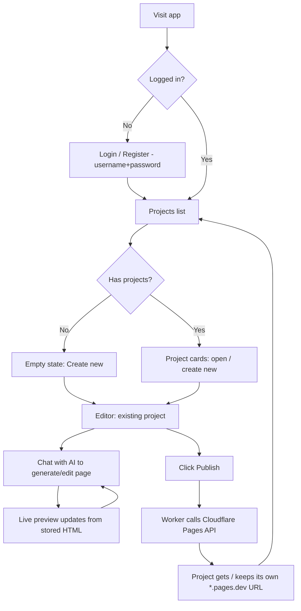
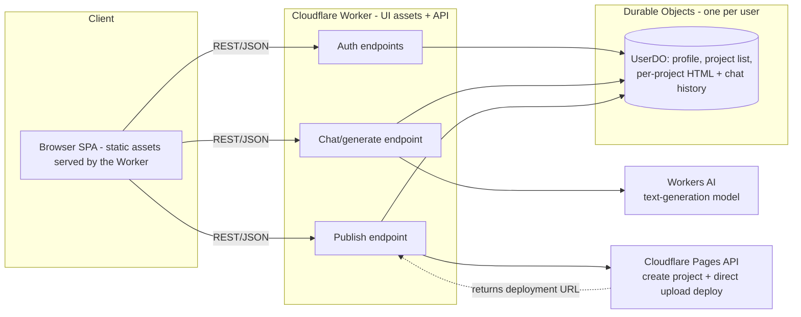
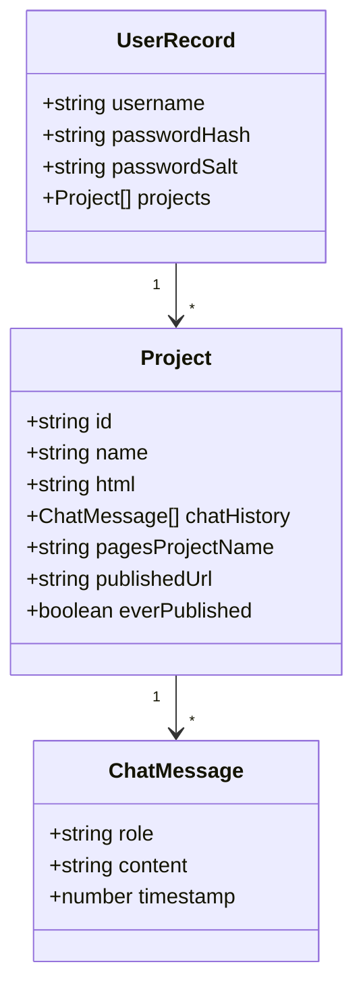

# AI Chat-Based HTML Page Builder — Design

## Intent & Why

A minimal side project: users log in, chat with an AI to describe a
webpage, see it rendered live, and publish it to its own public URL —
all on Cloudflare infrastructure (Pages, Workers, Workers AI, Durable
Objects). No heavy engineering: single-page sites, simple auth, one
shared editing model.

## Goals

- Multi-user: each user has their own login and their own list of
  projects.
- Each project is **one single HTML page** (inline CSS/JS allowed).
- Chat-driven editing: describe changes in natural language, AI
  updates the page.
- Live preview while editing, before anything is published.
- One-click publish per project to its own Cloudflare Pages project,
  getting a default `*.pages.dev` URL.
- Mobile-friendly editor (chat and preview as separate views on small
  screens, side-by-side on larger ones).

## Non-Goals (for now)

- Multi-page sites (e.g. home + about + contact) — single page only.
- Custom domains per project — planned as a future feature, not now.
- OAuth/social login, email verification, password reset flows.
- Real-time multi-user collaboration on the same project.
- Granular roles/permissions — every user only ever manages their own
  projects.
- Billing/payments.
- Full content moderation — only a basic automated safeguard on
  publish (see "Publish Flow"), not human review or appeals.

## Anti-Goals

- Would fail even if "technically working": requiring users to touch
  `wrangler` or the Cloudflare dashboard directly to publish. Publish
  must be a single in-app button.
- Over-engineering the data layer (e.g. a separate DO per chat
  message, or a relational schema) for what is a small side project.

## Prior Art / Feel

Similar in spirit to tools like v0.dev / bolt.new (chat → live
preview → deploy), but intentionally much smaller in scope: one page,
one simple model, one deploy target.

## User Flow



## Preview Isolation

- The live preview iframe renders the project's current HTML via
  `srcdoc`, with a restrictive `sandbox` attribute and **no**
  `allow-same-origin`. This means AI-generated (or adversarial) HTML
  in the preview can never read the editor's cookies, call the
  authenticated API, or otherwise touch the parent app's session,
  regardless of hosting origin. **My call** — a security property the
  implementation must preserve, not a product decision.

## Editor Layout

- **Desktop/tablet:** two panes side by side — chat on the left,
  live preview (iframe) on the right.
- **Mobile:** single pane with a toggle/tab to switch between "Chat"
  and "Preview" (not both at once).
- A "Publish" button is always visible in the editor header, plus the
  current published URL (if any) once a project has been published at
  least once.

## Architecture



**The app's own UI is served by the Worker itself** (Wrangler's
`[assets]` static-assets binding, pointing at `web/`), not deployed as
a separate Cloudflare Pages project. UI and API share one origin, so
the `SameSite=Lax` session cookie works with no CORS, and the whole app
ships with a single `wrangler deploy`. This only concerns hosting the
builder's login/projects/editor UI; publishing *user* projects still
creates one Cloudflare Pages project per user project via the Pages API,
as described in Publish Flow. **Ruled during final review.**

**Why one Durable Object per user:** keeps the data model trivial for
a small side project — no need for a separate DO per project or a
database. The DO instance is addressed by username (or a stable user
id) and stores everything that user owns: credentials (hashed
password), and a map of projects (id → name, current HTML, chat
history, publish status/URL). Durable Object storage (`storage.get` /
`put`) with a single JSON blob per user is plenty at this scale.
**My call** — revisit only if a user's data outgrows a single DO's
storage limits, which a handful of single-page sites won't.

## Data Model (inside a user's Durable Object)



## Auth (deliberately simple)

- Username + password only, no email required.
- Password hashed with a salted hash using the Web Crypto API
  (available natively in Workers) — e.g. PBKDF2-SHA256 with a random
  per-user salt. **My call**, no external bcrypt dependency needed.
- Session: a signed cookie (HMAC over username + expiry, using a
  secret bound to the Worker) — no JWT library, no session store
  needed since the signature itself is the proof. **My call.**
- No password reset flow in this version; a non-goal.
- Logout clears the browser's cookie but cannot revoke an already-issued
  token server-side, since there is no session store — a captured/replayed
  session cookie stays valid until its TTL expires even after "logout."
  **My call**, accepted consequence of the stateless-cookie design; revisit
  only if this app ever needs real-time revocation (short TTLs + rotation,
  or a lightweight denylist, would be the fix).

## AI Editing Behavior

- Each chat turn sends the **full current HTML** plus the new user
  message to the AI model, and the AI returns the **full new HTML**
  for the page (not a diff/patch).
- **Why:** targeted patching requires either diffing instructions
  (fragile with small/medium models) or a more complex tool-call
  setup. Full regeneration with the current HTML as context is simpler
  to implement correctly and keeps the AI self-consistent, at the cost
  of occasionally changing something unrelated. **My call** — worth
  revisiting later if regenerations prove too unstable, but acceptable
  for a minimal version.
- Model: a Workers AI instruction-following text model (e.g. a Llama
  3.x instruct model available on Workers AI). Exact model id is an
  implementation detail/**left to the builder**, swappable without
  affecting the rest of the design.
- Chat history is stored per project so context carries across
  sessions, but only the latest HTML + latest user message are sent
  to the model each turn (not the full chat transcript) to keep
  prompts small. **My call** — can be revisited if the AI starts losing
  track of earlier intent.

### Streaming responses

- The AI's reply streams into the chat token-by-token as it
  generates, like a typical chat assistant, so it feels alive instead
  of a long silent wait.
- Mechanism: the Worker calls Workers AI with streaming enabled and
  pipes the chunks straight through to the browser as a streamed HTTP
  response (SSE/`ReadableStream`); the client appends each chunk to
  the in-progress chat message as it arrives. No WebSocket or Durable
  Object connection is needed for this — it's a single request/response
  stream per chat turn, not a push channel to multiple clients.
  **My call**, confirmed sufficient since only one device per project
  session is in scope (no multi-device sync requirement).
- The **live preview does not update token-by-token.** The model is
  producing raw HTML text, which is invalid/unsafe to render until
  the full document is complete. The preview iframe refreshes once
  the full HTML has been received, parsed, and stored — the chat
  bubble streams live, the preview updates a moment later when
  generation finishes. **My call.**

## Publish Flow

```mermaid
sequenceDiagram
    participant U as User (Browser)
    participant W as Worker API
    participant DO as UserDO
    participant CF as Cloudflare Pages API

    U->>W: POST /publish {projectId}
    W->>DO: load project HTML + pagesProjectName
    alt first publish for this project
        W->>CF: create Pages project (name derived from user+project)
        CF-->>W: project created, default subdomain
        W->>DO: store pagesProjectName + stable https://subdomain URL (before deploying, so a failed deploy is retried without re-creating)
    end
    W->>CF: direct-upload deployment with index.html = project.html
    CF-->>W: deployment URL (per-deployment; not stored)
    W->>DO: store pagesProjectName + publishedUrl + everPublished=true
    W-->>U: publishedUrl
```

- Every project gets its **own** Cloudflare Pages project (not a
  shared project with path-based routing) — confirmed by the user.
  This gives each project its own default `*.pages.dev` domain from
  day one, and makes "connect custom domain" a natural per-project
  feature to add later (Cloudflare Pages supports custom domains per
  project).
- Pages project names must be derived deterministically from
  user + project (e.g. slugified `username-projectslug`, with
  collision suffixing if needed) and stored once created, since
  Cloudflare Pages project names are globally unique on the account.
  **Left to the builder** for exact slugging/collision strategy.
- Publishing deploys a single `index.html` file (the project's stored
  HTML) via the Pages direct-upload API — no build step, no git
  integration needed.
- The Worker holds the Cloudflare API token/account id as secrets;
  these are never exposed to the browser.
- **Basic abuse safeguard:** before each publish, run the project's
  HTML through a lightweight automated check (e.g. a small set of
  pattern/keyword rules for obvious phishing or credential-harvesting
  shapes — login-style forms posting to external domains, brand
  impersonation keywords, etc.) and block the publish with an error
  if it trips. This is a basic filter, not full moderation or human
  review — intentionally cheap for a small side project, confirmed by
  the user as sufficient for now. **Left to the builder** for the
  exact rule set.

## Delete

- Users can delete a project. Deleting:
  1. Calls the Cloudflare Pages API to delete the project's Pages
     project (if it was ever published), freeing that slot on the
     account.
  2. Removes the project entry (HTML, chat history, publish info)
     from the user's Durable Object storage.
- If the Pages-project deletion call fails (e.g. transient API
  error), the project is **not** removed from the user's list, and
  the user sees an error asking them to retry — this avoids orphaning
  a live Pages project with no owner in the data model. **My call.**

## What's Left to the Builder

- Exact Workers AI model id and prompt template for the
  generate/edit step.
- Exact routes/request-response shapes for the Worker API.
- Pages project naming/slug collision handling.
- Frontend framework/tooling choice for the SPA (plain JS, React,
  Svelte, etc.) — not architecturally significant at this scale.
- Minor UI details (empty states, loading indicators, error display).
